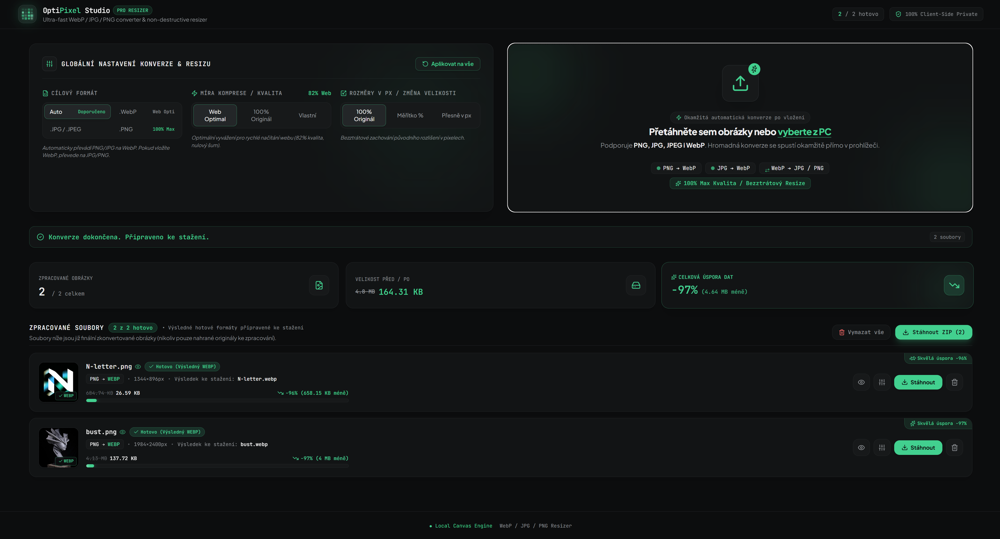

# OptiPixel Studio ⚡🖼️

> **Moderní, bleskurychlý a soukromý převodník a bezztrátový pixel resizer obrázků** běžící 100% lokálně ve vašem prohlížeči.


---



---

## 🌟 Klíčové funkce

### 1. 🔄 Univerzální konverze formátů
- **Výchozí WebP optimalizace:** Převeďte objemné JPEG a PNG soubory do moderního formátu `.webp` s úsporou až 80 % velikosti při zachování špičkové vizuální ostrosti.
- **Zpětný převod:** Automaticky rozpozná vstupní `.webp` a nabídne konverzi zpět do `.jpg` nebo `.png`.
- **Chytrá autodetekce (Auto-Detect):** Okamžitě zvolí nejvhodnější cílový formát na základě vstupního souboru.
- **Manuální volba:** Možnost vynutit převod do WebP, JPEG nebo PNG globálně i pro jednotlivé obrázky.

### 2. 🎛️ Flexibilní kontrola kvality & komprese
- **Web Optimal (82 %):** Vybalancovaný poměr mezi dramatickou redukcí datové velikosti a prémiovou vizuální kvalitou pro webové stránky a e-shopy.
- **100% Max / Lossless:** Maximální bezztrátová kvalita věrná originálu bez kompresních artefaktů.
- **Vlastní slider (Custom 1–100 %):** Možnost doladit přesnou úroveň kvality s okamžitým přepočtem velikosti.

### 3. 📐 Přesný Pixel Resizer (Změna rozměrů)
- **Původní rozlišení (1:1):** Zachování přesných rozměrů originálu.
- **Rychlá procentuální měřítka:** Přednastavené zmenšení na 75 %, 50 % nebo 25 %.
- **Vlastní rozměry v pixelech:** Zadejte přesnou šířku a výšku v px.
- **Zámek poměru stran (Aspect Ratio Lock):** Automatický dopočet výšky při změně šířky (a naopak), aby nedocházelo k deformaci obrazu.

### 4. 🔍 Interaktivní detail & porovnání (Before / After Split)
- **Rozkliknutí detailu obrázku:** Zobrazení originálu a optimalizovaného výsledku ve vysokém rozlišení.
- **Interaktivní Split Slider:** Přetahovací posuvník pro porovnání pixel po pixelu přímo na obrazovce.
- **Zobrazení bok po boku (Side by Side):** Okamžitá kontrola ostrosti detailů a barevného podání.
- **Přímé stažení:** Tlačítko pro stažení hotového obrázku přímo z detailu se správným názvem a příponou.

### 5. 📦 Hromadné dávkové zpracování (Batch Processing)
- Přetáhněte desítky obrázků najednou přes přehlednou Drag & Drop zónu.
- Jednotlivé stahování souborů s přehlednou statistikou ušetřených dat.
- **Stažení všech souborů jako ZIP:** Generování jednoho komprimovaného ZIP archivu přímo v prohlížeči pomocí JSZip.
- **Souhrnný dashboard úspor:** Reálný přehled celkové úspory v MB a procentech.

### 6. 🔒 100% Soukromí a bezpečnost (Privacy First)
- **Vše probíhá lokálně:** Obrázky se zpracovávají výhradně v paměti vašeho prohlížeče pomocí HTML5 Canvas a File API.
- **Žádné odesílání na server:** Vaše fotografie, screenshoty a citlivá grafika nikdy neopouštějí vaše zařízení.
- **Zero Paid APIs:** Aplikace nevyužívá žádné placené API, žádné externí cloudy ani předplatné.
- Funguje 100% offline a bez nutnosti registrace či API klíčů.

---

## 🛡️ Bezpečnostní audit (GitHub Ready)

Aplikace byla před zveřejněním na GitHub zkontrolována z hlediska bezpečnosti a ochrany dat:

| Bezpečnostní aspekt | Stav | Podrobnosti |
|---|---|---|
| **Placené služby / API** | ✅ **Žádné (0 Kč / $0)** | Žádné napojení na placené konvertory (CloudConvert, TinyPNG apod.) ani placené AI modely. |
| **Odesílání dat (Síť)** | ✅ **0 síťových požadavků** | Kód neobsahuje žádné `fetch`, `axios` ani `WebSocket` volání pro zpracování souborů. |
| **Telemetrie a sledování** | ✅ **Žádná telemetrie** | Žádné Google Analytics, trackery, cookie bannery ani reklamní skripty. |
| **API klíče a tajná data** | ✅ **Žádné tajné klíče** | Repozitář neobsahuje žádné tokeny, privátní klíče ani `.env` tajemství. |
| **Zranitelnosti závislostí** | ✅ **0 zranitelností** | Čistý audit závislostí (`npm audit: 0 vulnerabilities`). |
| **Správa paměti v prohlížeči** | ✅ **Chráněno** | Všechny dočasné `blob:` URL adresy jsou po stažení bezpečně uvolněny přes `URL.revokeObjectURL`. |
| **XSS & Injection ochrana** | ✅ **Chráněno** | Žádný `dangerouslySetInnerHTML`, žádný `eval()`. Vstupní soubory prochází validací MIME typů. |

---

## 🛠️ Použité technologie

| Technologie | Účel |
|---|---|
| **React 19** | Moderní reaktivní UI knihovna |
| **TypeScript** | Typová bezpečnost a robustní kód |
| **Vite 6** | Bleskurychlý bundler a vývojové prostředí |
| **Tailwind CSS v4** | Moderní utilitární stylování s designovými tokeny |
| **Motion (Framer Motion)** | Fyzikálně přesné pružinové animace a layout přechody |
| **Lucide React** | Čisté a konzistentní vektorové ikony |
| **JSZip** | Klientské balení zkonvertovaných obrázků do ZIP archivu |
| **HTML5 Canvas API** | Vysoce optimalizovaný resizing a komprese obrázků |

---

## 🚀 Rychlý start (Instalace a spuštění)

### Požadavky
- [Node.js](https://nodejs.org/) (verze 18 nebo novější)
- Správce balíčků: `npm`, `pnpm` nebo `yarn`

### Instalace závislostí
```bash
npm install
```

### Spuštění vývojového serveru
```bash
npm run dev
```
Aplikace se spustí na adrese [http://localhost:3000](http://localhost:3000).

### Sestavení pro produkci
```bash
npm run build
```
Výsledné statické soubory budou připraveny ve složce `dist/` k okamžitému nasazení (např. Vercel, Netlify, Cloudflare Pages, GitHub Pages).

### Kontrola typů (Lint)
```bash
npm run lint
```

---

## 📁 Struktura projektu

```text
├── index.html                   # Vstupní HTML soubor s metadata a SEO
├── package.json                 # Závislosti a skripty projektu
├── tsconfig.json                # Konfigurace TypeScriptu
├── vite.config.ts               # Konfigurace Vite bundleru
├── src/
│   ├── main.tsx                 # Vstupní bod React aplikace
│   ├── App.tsx                  # Hlavní layout aplikace a stav konverzí
│   ├── index.css                # Tailwind CSS v4 konfigurace, fonty a téma
│   ├── types.ts                 # TypeScript definice a rozhraní
│   ├── assets/                  # Statické vizuální assety a náhledy aplikace
│   ├── components/
│   │   ├── Header.tsx           # Horní lišta s logem, brandingem a akcemi
│   │   ├── ControlPanel.tsx     # Levý panel globálního nastavení (formát, kvalita, px)
│   │   ├── DropZone.tsx         # Pravý panel pro Drag & Drop nahrávání souborů
│   │   ├── ImageCard.tsx        # Karta zpracovaného obrázku se statistikou a volbami
│   │   ├── ComparisonModal.tsx  # Modální okno pro Split & Side-by-Side porovnání
│   │   └── SummaryStats.tsx     # Statistiky celkové úspory a přehled dávky
│   └── utils/
│       └── converter.ts         # Jádro konverze (Canvas API, rozměry, MIME typy)
```

---

## 📄 Licence

Tento projekt je licencován pod licencí [Apache-2.0](LICENSE).
